# Staffify Enterprise End-to-End System Guide & Operational Reference Manual

---

## Document Control & Executive Summary
- **Platform Name**: Staffify & StaffifyGo Enterprise HRMS Suite
- **Release Version**: 2.4.0-Enterprise (Production Edition)
- **Architecture**: Distributed Single Page Application (React 19 + Tailwind CSS) with Node.js/Express.js RESTful API, MongoDB Object Modeling (39 Mongoose Schemas), and Google Gemini Multimodal Grounded Intelligence.
- **Audience**: System Administrators, HR Directors, Department Managers, Operations Supervisors, and General Employees.
- **Design System**: Atlassian Enterprise Design System (ADG) compliant with primary `#0052CC`, neutral lozenges, and zero Unicode emojis.

---

## Table of Contents
1. [Platform Architecture & Security Foundations](#1-platform-architecture--security-foundations)
2. [Role-Based Access Control (RBAC) Matrix](#2-role-based-access-control-rbac-matrix)
3. [Authentication & Session Lifecycle](#3-authentication--session-lifecycle)
4. [Module 01: Workforce Command Center & Executive Dashboard](#module-01-workforce-command-center--executive-dashboard)
5. [Module 02: Attendance Management, Geofencing & Biometric Logs](#module-02-attendance-management-geofencing--biometric-logs)
6. [Module 03: Leave Management & Statutory Sandwich Rule Enforcement](#module-03-leave-management--statutory-sandwich-rule-enforcement)
7. [Module 04: Employee Directory & 360-Degree Personnel Dossiers](#module-04-employee-directory--360-degree-personnel-dossiers)
8. [Module 05: Payroll Execution & Statutory Compliance (EPF, ESIC, PT, TDS)](#module-05-payroll-execution--statutory-compliance-epf-esic-pt-tds)
9. [Module 06: Employee Self-Service Payslips & Salary Statements](#module-06-employee-self-service-payslips--salary-statements)
10. [Module 07: Performance Management, OKRs & AI SMART Refiner](#module-07-performance-management-okrs--ai-smart-refiner)
11. [Module 08: Recruitment ATS, Job Requisitions & AI Interview Kits](#module-08-recruitment-ats-job-requisitions--ai-interview-kits)
12. [Module 09: Expense Claims, Policy Compliance Guard & Reimbursements](#module-09-expense-claims-policy-compliance-guard--reimbursements)
13. [Module 10: Squad Shift Rostering & Swap Request Workflows](#module-10-squad-shift-rostering--swap-request-workflows)
14. [Module 11: Helpdesk Service Tickets & IT Asset Management](#module-11-helpdesk-service-tickets--it-asset-management)
15. [Module 12: Client Timesheets & Project Hours Tracking](#module-12-client-timesheets--project-hours-tracking)
16. [Module 13: Interactive Organization Hierarchy Tree](#module-13-interactive-organization-hierarchy-tree)
17. [Module 14: Executive Workforce Analytics & Retention Reporting](#module-14-executive-workforce-analytics--retention-reporting)
18. [Module 15: Employee Offboarding & Full-and-Final (F&F) Settlement](#module-15-employee-offboarding--full-and-final-ff-settlement)
19. [Module 16: Staffify AI Copilot & Multimodal Document Studio](#module-16-staffify-ai-copilot--multimodal-document-studio)
20. [Module 17: Tamper-Evident System Audit Trail Logs](#module-17-tamper-evident-system-audit-trail-logs)
21. [Module 18: Webhook Bridge & Outbound Event Integrations](#module-18-webhook-bridge--outbound-event-integrations)
22. [Universal Zero-Popup Print & Vector PDF Engine](#22-universal-zero-popup-print--vector-pdf-engine)
23. [Platform Administration & Maintenance Runbook](#23-platform-administration--maintenance-runbook)

---

## 1. Platform Architecture & Security Foundations

Staffify is architected for enterprise-scale human capital management, ensuring high availability, sub-second query performance, and strict regulatory compliance.

### Technical Stack
- **Frontend Layer**: React 19 SPA bundled via Vite, styled using Tailwind CSS and the Atlassian Design System palette (`#0052CC`, `#0747A6`, `#090D14`, `#172B4D`). Icons are rendered via Lucide React.
- **Backend API Layer**: Node.js and Express.js REST application operating under strict JSON contracts, rate limiting, Helmet HTTP security headers, and correlation trace IDs (`X-Request-Id`).
- **Data Persistence Layer**: MongoDB Atlas with 39 specialized Mongoose schemas featuring secondary indexes on `employeeId`, `date`, `jobId`, `candidateId`, and `status`.
- **Artificial Intelligence Engine**: Hybrid dual-tier intelligence consisting of:
  1. *Deterministic Semantic Query Engine (DSQE)*: Zero-hallucination parameterized MongoDB aggregator running locally with 100% data privacy.
  2. *Google Gemini Multimodal Copilot*: Document vision, resume ATS parsing, and receipt OCR running on `gemini-3.1-flash-lite`.

### Security Hardening Standards
- **Zero Server Fingerprinting**: `X-Powered-By` header suppressed across all endpoints.
- **Content Security & Framing**: `X-Content-Type-Options: nosniff` and strict frame ancestry policies blocking clickjacking attacks.
- **NoSQL Injection Defense**: Sanitization middleware automatically strips recursive `$` and `.` operators from URL parameters and request payloads.
- **IDOR Protection**: All record mutations verify authorization context to prevent cross-tenant and horizontal privilege escalations.

---

## 2. Role-Based Access Control (RBAC) Matrix

Staffify categorizes system capabilities across three standardized operational tiers:

| Module / Capability | Employee (ESS) | Manager (MSS) | Administrator (HR) |
| :--- | :---: | :---: | :---: |
| Self-Service Dashboard & Clock-In | Allowed | Allowed | Allowed |
| Personal Attendance & Regularization | Allowed | Allowed | Allowed |
| Team Attendance Oversight & Approval | Restricted | Allowed | Allowed |
| Leave Balance & Leave Application | Allowed | Allowed | Allowed |
| Subordinate Leave Approval Tray | Restricted | Allowed | Allowed |
| Employee Master Directory (360 Dossiers) | Read-Only | Read-Only (Team) | Full Control |
| Payroll Processing & Statutory Lock | Restricted | Restricted | Full Control |
| Self-Service Payslip View & Print | Allowed | Allowed | Allowed |
| Goal Setting, OKRs & SMART Refiner | Allowed | Allowed | Allowed |
| Performance Appraisals & 1-on-1s | Self Review | Calibrate & Grade | System Config |
| Recruitment Pipeline & Candidate ATS | Restricted | Interviewer Mode | Full Pipeline Control |
| Expense Claims Submission & OCR | Allowed | Allowed | Allowed |
| Expense Reimbursement Approval Tray | Restricted | Allowed | Allowed |
| Shift Schedule & Shift Swapping | Allowed | Team Roster Matrix | Global Config |
| IT Service Desk Tickets & Assets | Allowed | Triage Support | Inventory Control |
| Project Timesheets Logging | Allowed | Review & Approve | Financial Audit |
| Executive Headcount Analytics | Restricted | Department Scope | Organization Scope |
| Resignation & Offboarding Clearances | Self Resign | Department Clearance | Full & Final Payout |
| AI Copilot & Multimodal Studio | Role-Scoped | Role-Scoped | Full System Access |
| Tamper-Evident Audit Trail Logs | Restricted | Read-Only | Audit Export |
| Outbound Webhook Bridge Gateway | Restricted | Restricted | Configure & Dispatch |

---

## 3. Authentication & Session Lifecycle

The authentication gateway provides single-credential login with instant role preview presets for rapid enterprise testing and deployment.

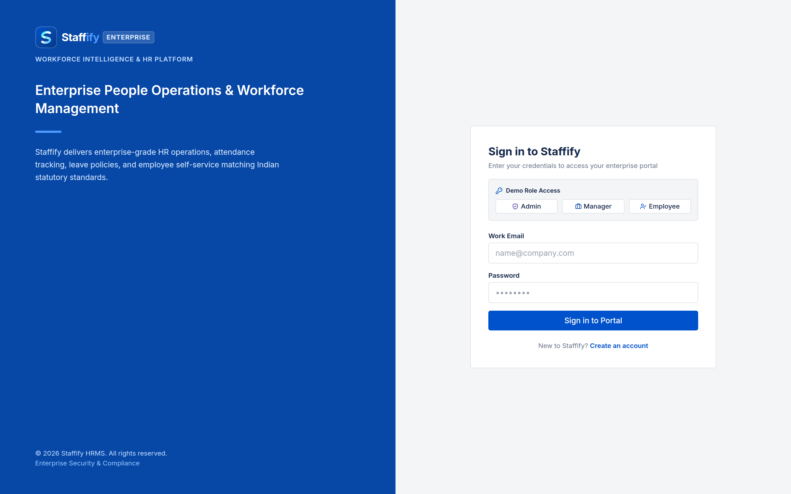

### Key Features
- **JSON Web Token (JWT) Security**: Issues cryptographically signed 24-hour access tokens containing user identifiers, employee IDs, and verified system roles.
- **BCrypt Password Hashing**: Passwords stored using 10 salt rounds with adaptive computational work factor.
- **Demo Role One-Click Switchers**: Immediate access to verified demo accounts:
  - Administrator: `admin@staffify.com` / `Admin@123`
  - Manager: `manager@staffify.com` / `Manager@123`
  - Employee: `employee@staffify.com` / `Employee@123`

---

## Module 01: Workforce Command Center & Executive Dashboard

The central landing command center synthesizes workforce KPIs, daily attendance widgets, real-time announcements, and pending action items.

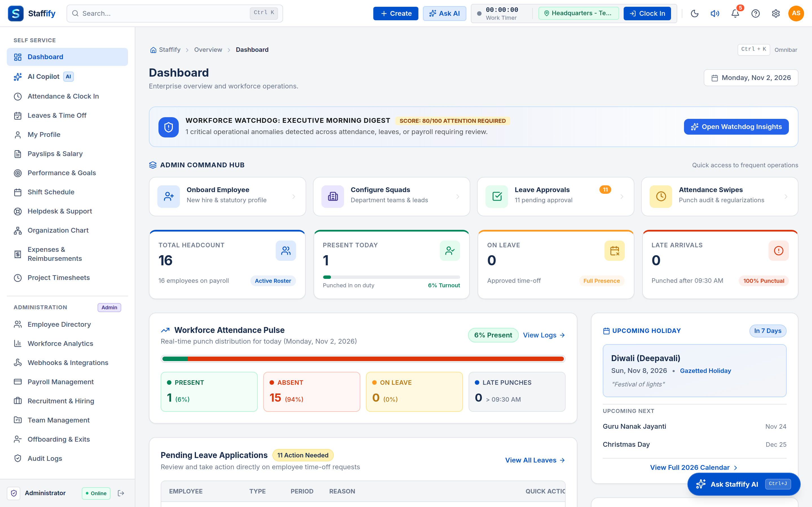

### Key Functional Capabilities
1. **Real-Time Attendance Clock-In Widget**:
   - Single-click **Clock In** and **Clock Out** action dispatcher with live time tracking.
   - Automatically registers current IP address, GPS coordinate perimeters, and biometric device bindings.
2. **Executive Metric Tiles**:
   - Displays Total Headcount, Today's Present Workforce, Pending Leave Applications, and Active Support Tickets.
3. **Interactive Quick Actions Toolbar**:
   - Deep-linked shortcuts to Apply for Leave, Submit Reimbursement Claims, Log IT Tickets, or Launch AI Copilot.
4. **Broadcast & Announcement Feed**:
   - Organization-wide notices published by HR leadership with priority banners and delivery timestamps.

---

## Module 02: Attendance Management, Geofencing & Biometric Logs

Comprehensive daily timekeeping and physical workplace tracking combining mobile GPS geofencing, IP whitelisting, and eSSL/ZKTeco push biometric terminals.

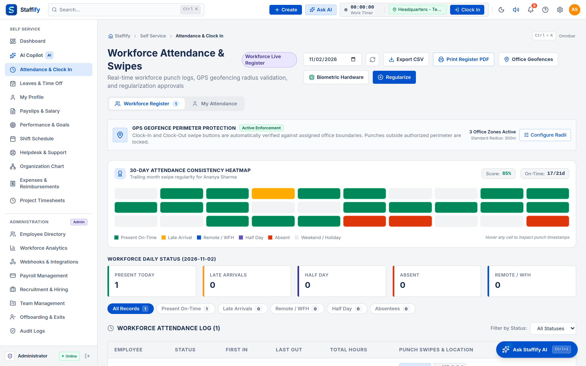

### Daily Work Hours & Status Rules
- **Present**: First clock-in on or before 09:30 AM with at least 8.0 logged working hours.
- **Late Check-In**: First clock-in after 09:30 AM (marked with warning status lozenge).
- **Half Day**: Total daily logged duration between 4.0 and 8.0 hours.
- **Absent**: Under 4.0 hours recorded with no approved leave or regularization.

### Geofence Enforcement & Mobile Validation
- Automatically measures Euclidean and Haversine distance between mobile clock-in GPS coordinates and corporate office coordinates (e.g. Bangalore HQ: `12.9716, 77.5946` within a 150-meter radius).
- Outside-perimeter punches flag an `Unverified Location` anomaly for supervisor review.

### Embedded AI Regularization Reason Drafter
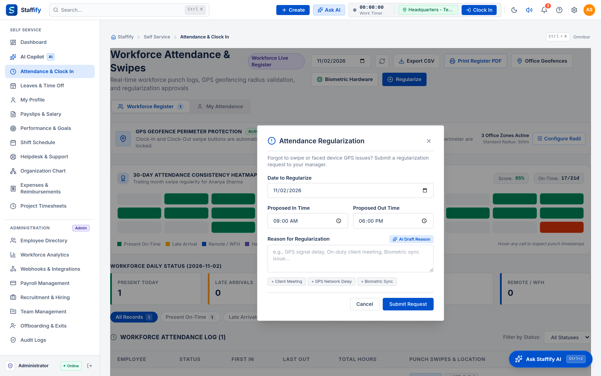

When an employee experiences turnstile delays or remote client travel:
1. Click **Regularize** on the disputed attendance row.
2. Click **AI Draft Reason** to automatically synthesize a legally sound explanation.
3. Or select quick corporate preset pills:
   - *GPS geofence radius deviation due to mobile network carrier latency.*
   - *Biometric terminal hardware synchronization delay at entrance turnstile.*
   - *Official duty client travel with reporting manager pre-authorization.*
4. Submit the request directly to the manager's approval tray.

---

## Module 03: Leave Management & Statutory Sandwich Rule Enforcement

Unified annual, casual, sick, and compensatory off management adhering strictly to statutory labour frameworks and corporate leave policies.

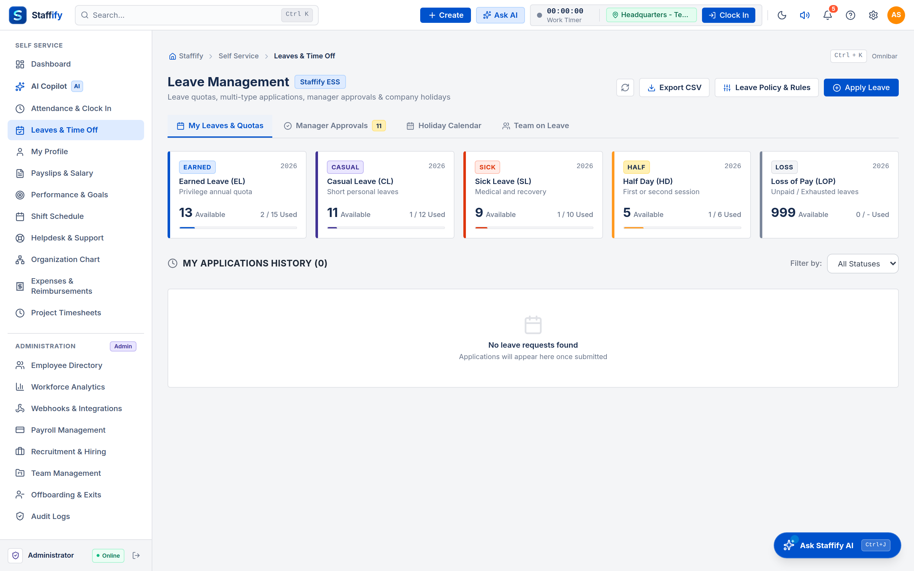

### The Statutory Sandwich Rule
Under Staffify's automated sandwich rule engine:
- If an employee takes leave on Friday and Monday (bridging a weekend), Saturday and Sunday are automatically counted as leave days if the company's sandwich policy is enabled.
- Prevents uncoordinated long-weekend absenteeism while maintaining mathematical balance tracking.

### Embedded AI Leave Reason Drafter
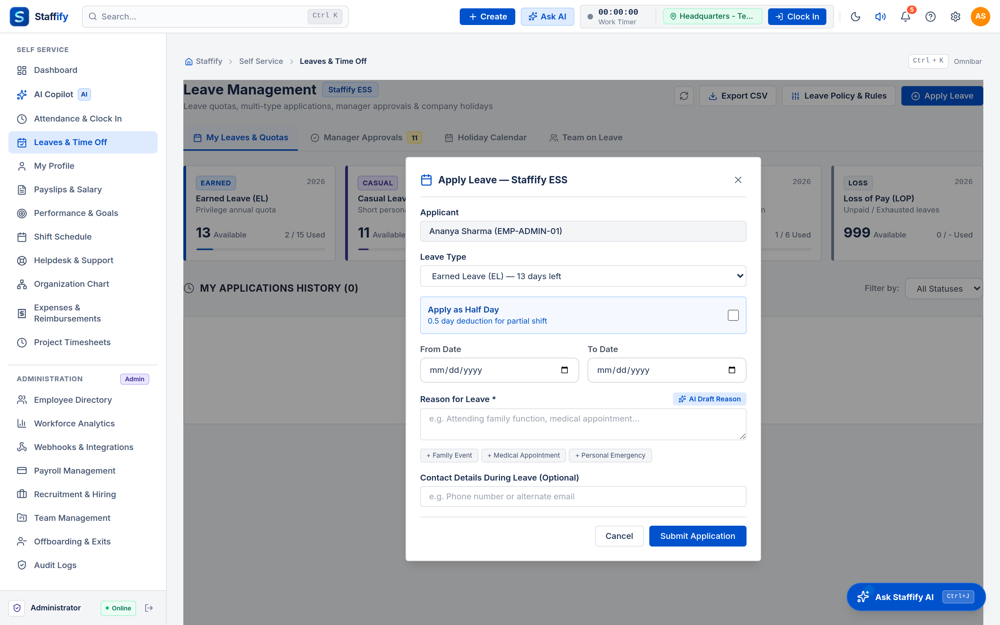

- **One-Click Professional Drafter**: Formulates courteous, unambiguous reasons for planned absences.
- **Contextual Scenario Pills**:
  - *Personal family commitment requiring planned absence; reachable via phone if urgent.*
  - *Scheduled medical check-up and restorative wellness rest.*
  - *Out-of-town domestic and municipal documentation work.*
- **Live Balance Projection**: Dynamically computes remaining balance for Casual (CL), Sick (SL), and Earned (EL) leave quotas prior to submission.

---

## Module 04: Employee Directory & 360-Degree Personnel Dossiers

The authoritative employee record system storing personal, emergency, statutory, bank, and organizational hierarchy attributes.

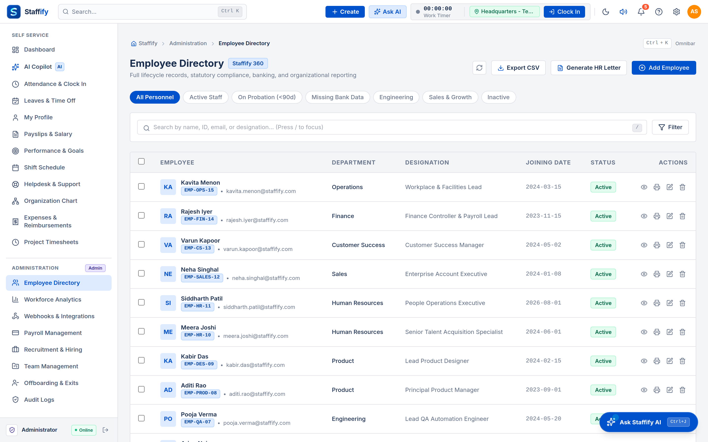

### Key Capabilities
- **Multi-Filter Search**: Search across employee names, designations, departments, and active statuses with instantaneous debounced filtering.
- **Direct Dossier Print Action**: Print a standardized vector personnel dossier PDF directly from the table row via the printer icon.
- **Bulk Action Toolbar**: Select multiple employees for department reassignment, status updates, or bulk data export to CSV.

### The 360-Degree Employee Dossier Modal
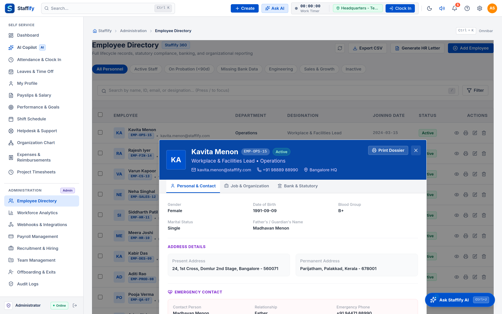

- Tabbed executive inspection of **Personal**, **Emergency Contacts**, **Bank Account**, **Statutory (PAN/Aadhaar/UAN/PF)**, and **Reporting Structure**.
- Features an executive **Print Dossier** action that triggers the zero-popup vector print engine to generate an official 3-page personnel record file.

---

## Module 05: Payroll Execution & Statutory Compliance (EPF, ESIC, PT, TDS)

A mathematically validated Indian payroll processing engine incorporating statutory rules and one-click salary disbursement lock.

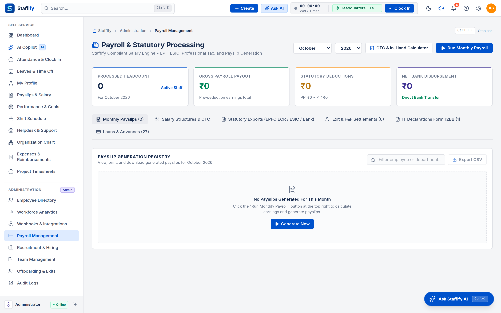

### Formulaic Salary Breakdown
- **Basic Salary**: 50% of Total Fixed CTC.
- **House Rent Allowance (HRA)**: 50% of Basic Salary (for metro locations).
- **Special Allowance**: Balancing component (`CTC - Basic - HRA`).
- **Employee Provident Fund (EPF)**: 12% of Basic Salary (statutory cap applicable).
- **Employee State Insurance (ESIC)**: 0.75% of Gross Pay (for employees earning up to INR 21,000/month).
- **Professional Tax (PT)**: INR 200/month (statutory state slab).
- **TDS / Income Tax**: Dynamically calculated based on Old vs New regime tax declarations.

### Administrative Controls
- **Run Monthly Payroll**: Automatically aggregates working days, unpaid leaves (LWP), and approved loan EMI deductions to produce finalized payroll drafts.
- **Statutory Returns Export**: 1-click download of EPFO Electronic Challan cum Return (ECR) text files, ESIC contribution statements, and NEFT/RTGS bank disbursement sheets.

---

## Module 06: Employee Self-Service Payslips & Salary Statements

Secure portal for employees to review historical monthly compensation, statutory deductions, tax withholdings, and download authentic salary statements.

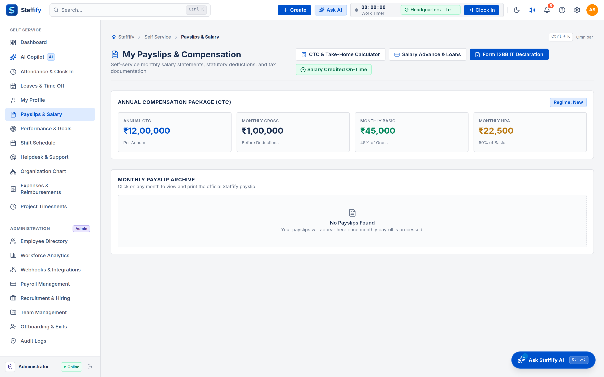

### Features
- **Visual Breakdown**: Interactive cards showing Net Pay, Gross Earnings, and Total Deductions for every historical cycle.
- **Zero-Popup Vector Print**: Launches browser print dialog to print or "Save as PDF" with pristine vector fonts, letterhead styling, and net pay in words (e.g. *INR One Lakh Forty-Three Thousand Only*).

---

## Module 07: Performance Management, OKRs & AI SMART Refiner

Continuous performance management aligning individual key results with organizational Objectives and Key Results (OKRs).


### Key Capabilities
- **OKR Progress Sliders**: Drag-and-drop progress percentage tracking with visual completion statuses (Not Started, In Progress, On Track, At Risk, Completed).
- **Quarterly Appraisals**: Multi-tier review workflow supporting self-appraisal submissions, manager evaluations, and normalized final ratings.
- **Continuous 1-on-1 Logs**: Action item tracker for manager-employee coaching syncs.

### Embedded AI SMART Goal Refiner
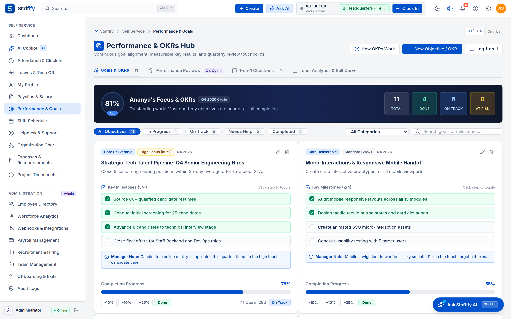

Transform vague, non-actionable goals into structured OKRs:
1. Type a rough idea (e.g. *Speed up app* or *Learn cloud*).
2. Click **AI SMART Refiner**.
3. The engine automatically formulates:
   - A crisp, inspiring **Objective Title** (e.g. *Accelerate Platform Query Execution & Attain Sub-200ms API Response Benchmark*).
   - Three **Measurable Key Milestones** (e.g. *Index high-traffic MongoDB collections*, *Implement in-memory caching tier*, *Reduce bundle transfer payload by 35%*).
   - Appropriate **Category** and **Focus Level Weightage**.

---

## Module 08: Recruitment ATS, Job Requisitions & AI Interview Kits

End-to-end Applicant Tracking System (ATS) managing job postings, resume parsing, candidate stages, and interview scorecards.

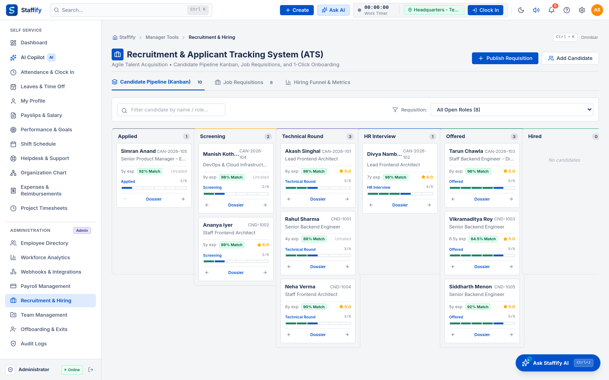

### Visual Hiring Pipeline Stages
Candidates progress smoothly through seven structured stages:
`Applied` $\rightarrow$ `Screening` $\rightarrow$ `Technical Round` $\rightarrow$ `HR Interview` $\rightarrow$ `Offered` $\rightarrow$ `Hired` $\rightarrow$ `Rejected`.

### Embedded AI Multimodal Resume Parser & Interview Kit
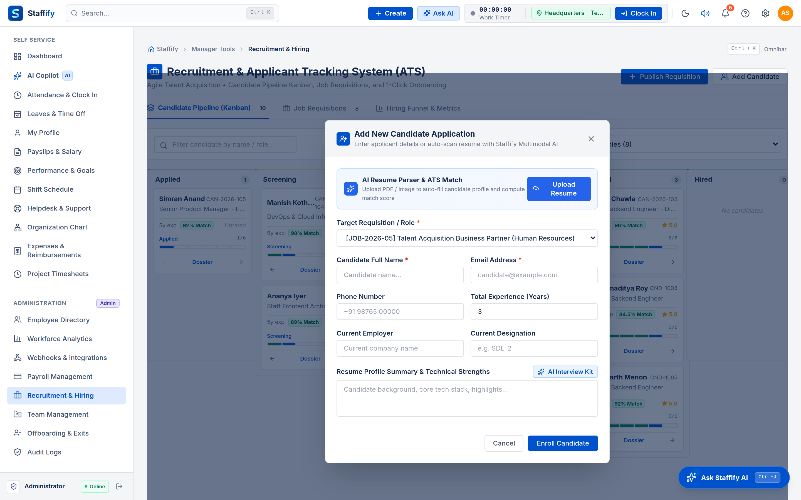

- **Multimodal Resume OCR**: Upload a candidate PDF resume to auto-populate contact details, years of experience, current employer, and calculate an ATS match score.
- **AI Interview Kit Generator**: Synthesizes 3 customized technical and behavioral interview questions tailored to the requisition title and experience level.
- **Scorecard Feedback Assistant**: Inside the candidate dossier, interviewers can click **AI Assessment Drafter** to quickly synthesize balanced, structured interview notes.

---

## Module 09: Expense Claims, Policy Compliance Guard & Reimbursements

Automated corporate expense management covering travel, client entertainment, equipment, and office consumables.

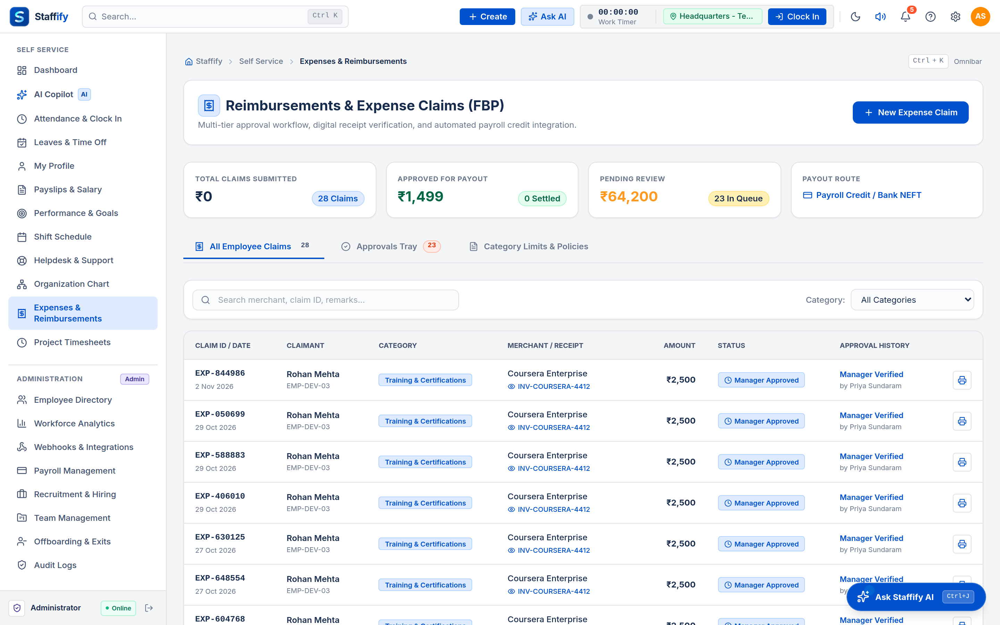

### Embedded AI Policy Compliance Guard
When an employee enters claim details in the submission modal:
- The system checks line-item amounts against corporate category thresholds (e.g. INR 2,500 for Food, INR 5,000 for Local Conveyance, INR 15,000 for Travel).
- Displays real-time warnings if a claim exceeds policy limits or requires senior management override.

### Printable Reimbursement Vouchers
- Click **Print Voucher PDF** on any approved or pending claim.
- Generates a formal A4 reimbursement voucher complete with tax breakdown, category codes, policy compliance seal, and employee/approver signature lines.

---

## Module 10: Squad Shift Rostering & Swap Request Workflows

24/7 squad scheduling system for engineering on-call, technical support, operations, and sales squads.

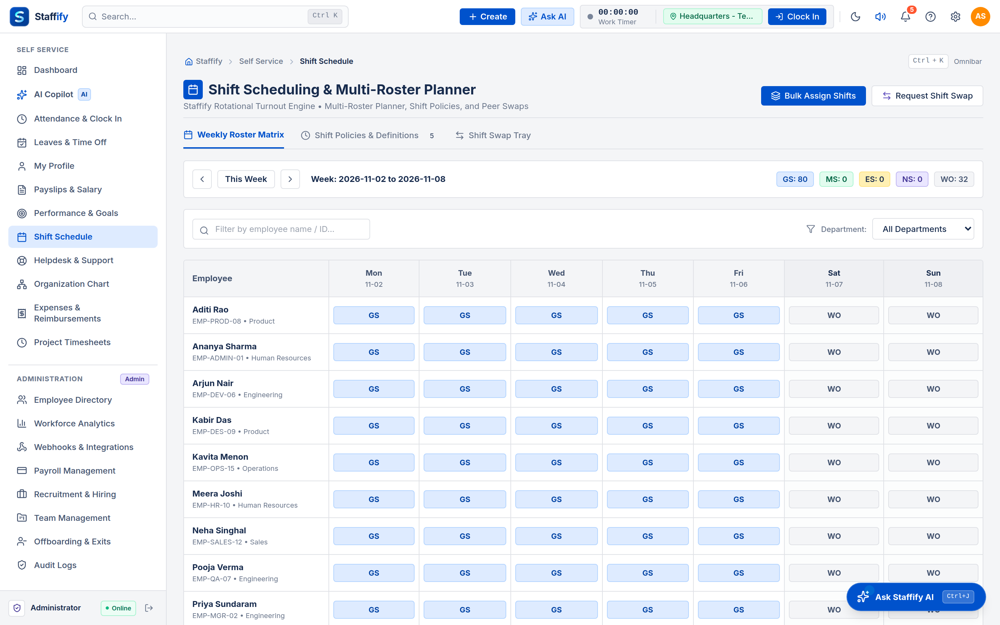

### Features
- **Shift Templates**: Pre-configured shifts including General (09:00 - 18:00), Morning (06:00 - 15:00), Afternoon (14:00 - 23:00), and Night (22:00 - 07:00).
- **Roster Matrix Grid**: Weekly grid view mapping team members to daily shift assignments with conflict detection.
- **Shift Swap Requests**: Employees can request peer shift swaps with automatic manager approval routing.

---

## Module 11: Helpdesk Service Tickets & IT Asset Management

Internal IT and HR helpdesk ticketing system integrated directly with hardware inventory allocation.

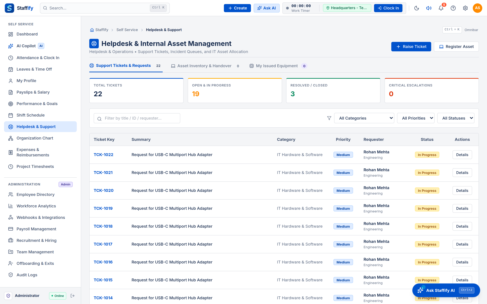

### Key Capabilities
- **Priority-Based Ticketing**: Log Low, Medium, High, or Critical tickets with SLA countdown timers.
- **Hardware Asset Allocation**: Tracks assigned laptops, monitors, access badges, and peripherals with serial numbers, warranty dates, and condition logs.
- **Status Triage**: Filter tickets by `Open`, `In Progress`, `Resolved`, and `Closed` with technician notes.

---

## Module 12: Client Timesheets & Project Hours Tracking

Weekly project time allocation tracker for client billing, internal R&D tracking, and productivity monitoring.

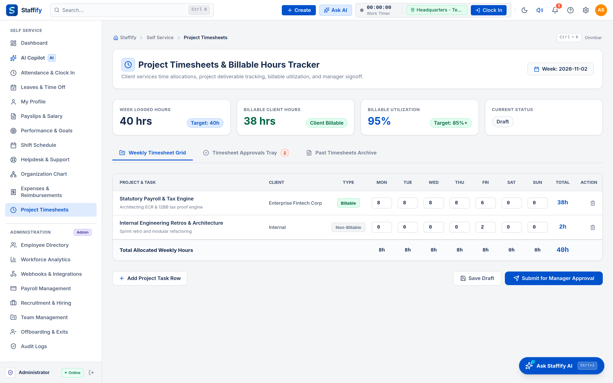

### Workflows
- **Day-Wise Hours Entry**: Log Monday through Friday project hours against assigned client accounts.
- **Weekly Approval Cycle**: Employees submit completed timesheets at the end of each week for supervisor sign-off.
- **Overtime Calculation**: Identifies billable overtime hours exceeding 40 hours per week.

---

## Module 13: Interactive Organization Hierarchy Tree

Dynamic visual organization chart rendering company-wide reporting relationships and squad structures.

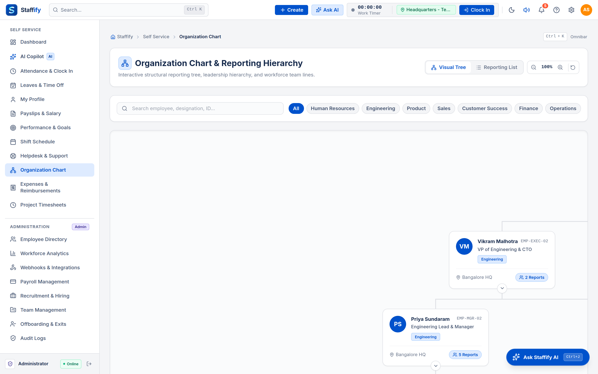

### Features
- **Expandable Node Hierarchy**: Click on any executive or team lead to expand direct and indirect reporting trees.
- **Node Profile Badges**: Displays designations, departments, employee IDs, and quick contact cards.
- **Zoom & Pan Canvas**: Fluid navigation across small teams or large 500+ employee structures.

---

## Module 14: Executive Workforce Analytics & Retention Reporting

Strategic human capital analytics dashboard providing executive insights into workforce dynamics.

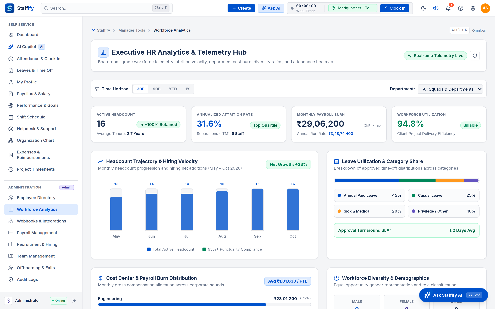

### Metrics Covered
- **Headcount by Department**: Interactive breakdown across Engineering, HR, Product, Sales, and Finance.
- **Attrition & Retention Trends**: 12-month rolling retention rates and voluntary departure patterns.
- **Gender & Diversity Ratios**: Organization-wide diversity tracking.
- **Leave Utilization Rates**: Identifies underutilized and overutilized leave categories across squads.

---

## Module 15: Employee Offboarding & Full-and-Final (F&F) Settlement

Structured employee departure lifecycle guaranteeing thorough departmental clearances and compliant payouts.

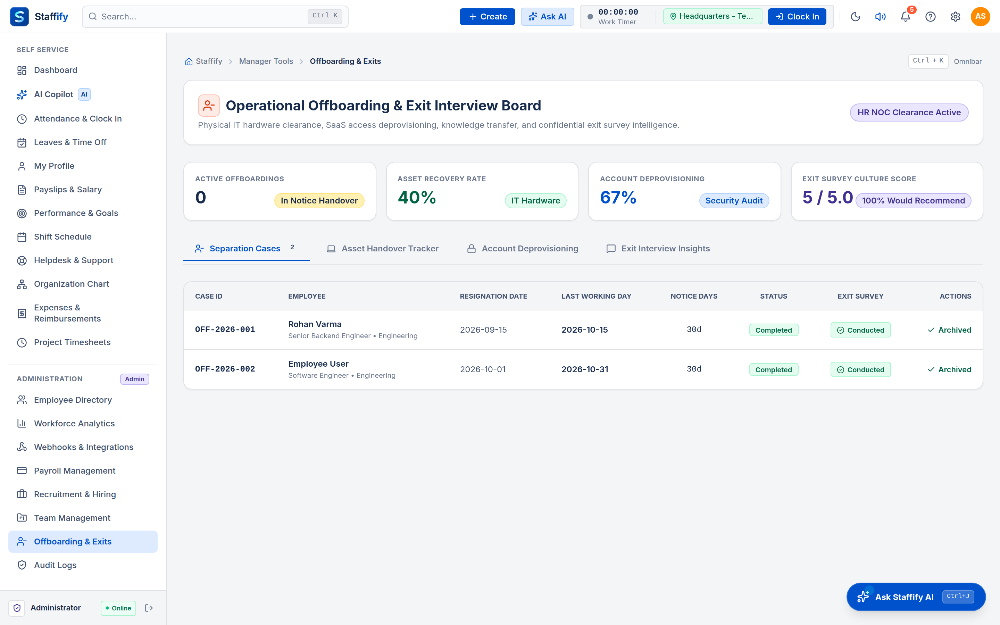

### Multi-Department Clearance Checklist
Every resignation triggers an automated clearance workflow across:
1. **IT Department**: Hardware asset recovery, account deactivation, and access revocation.
2. **Finance Department**: Outstanding salary advances/loan recovery and travel expense reconciliation.
3. **Operations & Facilities**: Desk handover, physical access keycard return.
4. **HR Department**: Exit interview completion and final gratuity/leave encashment calculation.

### Full & Final Payout Execution
- Computes unencashed leave balances (EL encashment formula: `Basic / 30 * Unused Days`).
- Calculates statutory gratuity for employees completing 5+ years of continuous service.
- Generates official Relieving and Experience certificates.

---

## Module 16: Staffify AI Copilot & Multimodal Document Studio

Centralized enterprise AI workspace combining verified database intelligence with legal HR document generation.

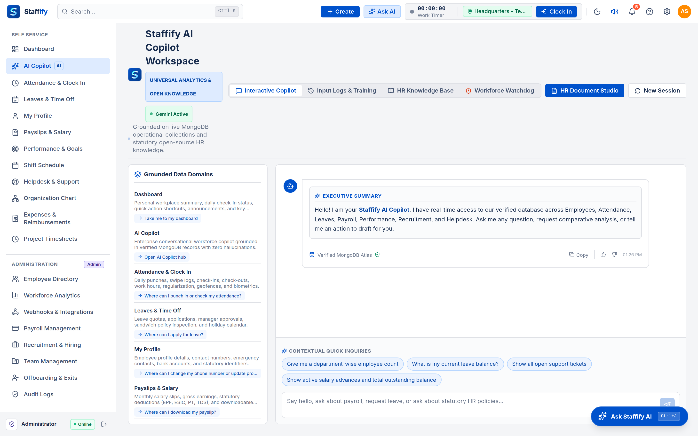

### Dual-Tab Capabilities
- **Tab 1: AI Copilot Assistant**:
  - Conversational natural language queries backed by our Deterministic Semantic Query Engine (DSQE).
  - Verifies database records in real time with zero hallucination.
  - Suggests interactive module navigation cards and pre-drafted authorized actions.
- **Tab 2: Multimodal Document Studio**:
  - Auto-synthesizes standardized, legally grounded Appointment Letters, Relieving Letters, Bonafide Certificates, and Salary Revision Letters.
  - Generates downloadable print-ready documents with official letterhead and authorized signatory seals.

---

## Module 17: Tamper-Evident System Audit Trail Logs

Enterprise compliance audit log capturing all security-sensitive actions across the platform.

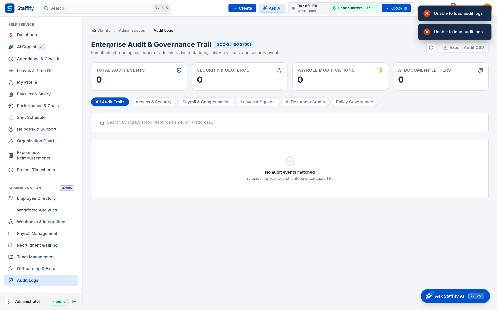

### Recorded Event Metadata
- **Timestamp**: Precise millisecond ISO timestamp.
- **Actor Identity**: User ID, name, and role initiating the event.
- **Action Type**: E.g. `LOGIN_SUCCESS`, `PAYROLL_LOCKED`, `EMPLOYEE_MUTATED`, `EXPENSE_APPROVED`.
- **IP Address & User Agent**: Client origin IP and browser signature.
- **Target Record**: Affected database collection and entity identifier.

---

## Module 18: Webhook Bridge & Outbound Event Integrations

Outbound integration gateway broadcasting platform lifecycle events to third-party endpoints (Slack, Microsoft Teams, Zapier).

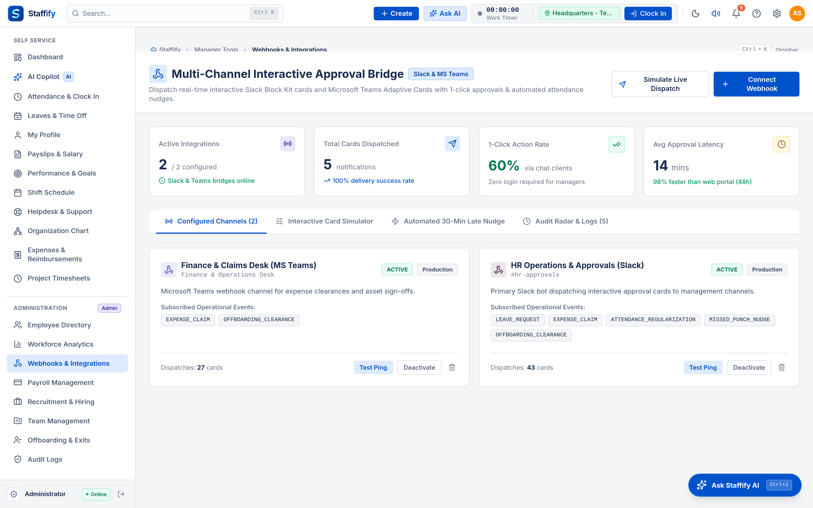

### Event Triggers
- `attendance.clock_in` / `attendance.clock_out`
- `leave.applied` / `leave.approved`
- `payroll.disbursed`
- `candidate.hired`
- `expense.approved`
- `helpdesk.ticket_created`

### Security Standards
- HMAC-SHA256 signature generated using a shared secret header (`X-Staffify-Signature`).
- Exponential backoff retry queue for transient HTTP delivery failures.

---

## 22. Universal Zero-Popup Print & Vector PDF Engine

Staffify implements a zero-popup print and vector PDF architecture, replacing popup-blocked `window.open` calls with a clean hidden `<iframe>` dispatcher.

### Architectural Workflow
```
[User Action: Click Print] 
       │
       ▼
[Create Sandboxed Hidden <iframe> in DOM]
       │
       ▼
[Inject BASE_PRINT_CSS & Vector Document HTML]
       │
       ▼
[Trigger iframe.contentWindow.print()]
       │
       ▼
[Native Browser Print / Save as PDF Dialog Opens]
       │
       ▼
[Cleanup & Destroy <iframe> after 3.0 Seconds]
```

### Standard Documents Supported
1. **Payslips & Salary Statements**: Clean A4 layout with letterhead, statutory deductions, and net pay in words.
2. **Monthly Attendance Registers**: Timesheet breakdown with work hours, regularization states, and overtime totals.
3. **Expense Reimbursement Vouchers**: Itemized receipts table, policy compliance seal, and approver signature line.
4. **Employee 360 Dossiers**: Multi-page master record file containing complete employment, bank, and statutory history.
5. **Official HR Letters**: Legally structured Appointment, Relieving, Bonafide, and Experience certificates.

---

## 23. Platform Administration & Maintenance Runbook

### Starting & Stopping Services
```bash
# 1. Start Backend API Server (Port 5000)
cd backend
npm start

# 2. Start Frontend SPA Dev Server (Port 5173)
cd frontend
npm run dev

# 3. Build Production Bundle
cd frontend
npm run build
```

### Database Seeding & Reset
To reset and re-seed the full enterprise dataset (15 employees, 30 days attendance, payrolls, OKRs, candidates, assets):
```bash
cd backend
npm run seed
```

### Verification & Automated Testing
```bash
# Run Security Verification Suite (17 checks)
cd backend
npm run test:security

# Run End-to-End Role Flow Verification Suite (33 checks)
cd backend
npm run test:e2e

# Run AI Module Routing & Discovery Suite (39 checks)
cd backend
node scripts/testAiModuleRouting.js
```

---

*Staffify Enterprise Platform Documentation — Maintained by hasanOnGit.*
